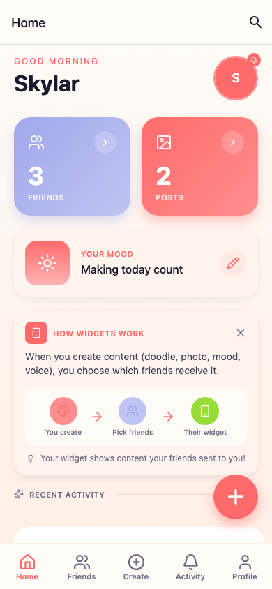
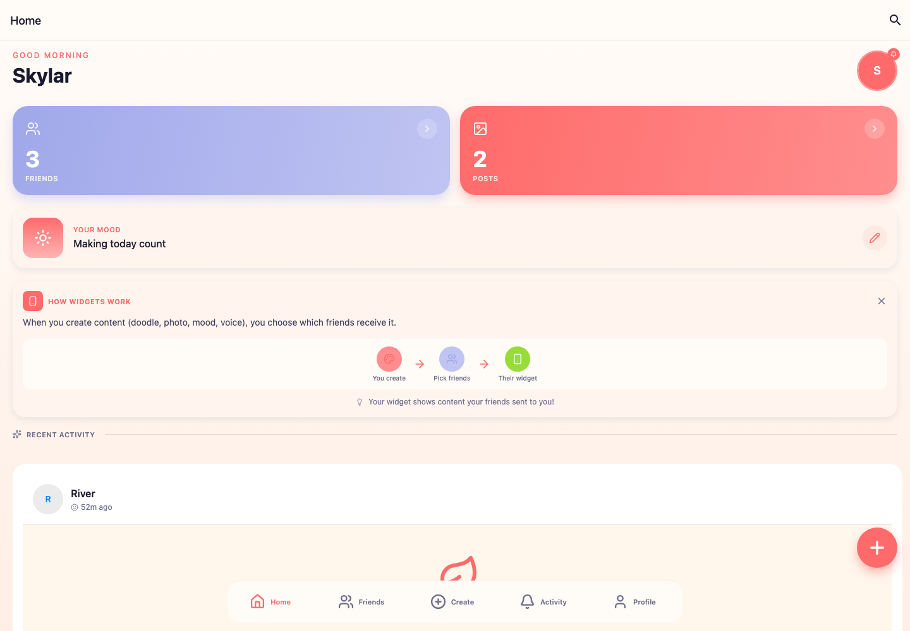

# Loop

A widget-first social playground built with Expo and React Native. Loop explores small, expressive updates—moods, doodles, photos, voice notes, and lightweight games—shared with a close group of friends.

This public edition opens directly into a deterministic, credential-free demo. It contains no live account, deployment, customer, or project data.



## Features

- Credential-free demo with deterministic users, friends, moods, and activity
- Expo Router navigation for iOS, Android, and web
- Mood, doodle, photo, voice-note, and game creation flows
- Friend discovery and profile surfaces
- Realtime-ready state architecture with Zustand and Supabase adapters
- Optional iOS home-screen widget target
- Responsive web navigation and accessible motion preferences

## Screenshots

| Responsive mobile preview | Desktop web preview |
| --- | --- |
|  |  |

Both images were captured from the built static web application. The mobile proof uses a 390 × 844 Chromium viewport; the desktop proof uses 1440 × 1000.

## Architecture

```text
app/                 Expo Router screens and route layouts
components/          Reusable UI, cards, canvas, and feedback states
hooks/               Device, realtime, notification, and domain hooks
lib/config.ts        Validated public runtime configuration
lib/demoFixtures.ts  Deterministic local demo dataset
providers/           Theme, notifications, query, and realtime boundaries
stores/               Persisted Zustand domain stores
targets/              Optional SwiftUI widget target
```

At startup, `resolveRuntimeConfig` chooses demo mode unless it is explicitly disabled. Demo startup seeds fresh copies of the fixtures into the stores and bypasses remote authentication. With demo mode disabled and a valid backend URL/key, the existing Supabase adapters become available.

## Quick start

### Requirements

- Node.js 20.19.4 or newer (required by the patched Metro toolchain)
- npm 10 or newer

```bash
npm ci
npm start
```

Press `w` for web, or use an Expo-compatible simulator/device. To build the static web edition:

```bash
npm run build:web
npx serve -s dist
```

## Configuration

Copy the placeholder file if you want explicit local settings:

```bash
cp .env.example .env
```

```dotenv
EXPO_PUBLIC_DEMO_MODE=true
EXPO_PUBLIC_SUPABASE_URL=
EXPO_PUBLIC_SUPABASE_ANON_KEY=
EXPO_PUBLIC_SENTRY_DSN=
```

`EXPO_PUBLIC_*` variables are bundled into the client and **must never contain secrets**. Demo mode is the supported out-of-the-box path. Connecting a backend requires your own compatible schema, storage policies, authentication setup, and Row Level Security; production infrastructure is intentionally not included.

## Validation

```bash
npm test -- --runInBand
npm run typecheck
npm run lint
npm run build:web
npx expo config --type public
npx expo-doctor
npm audit --omit=dev
```

The lockfile pins compatible security patches for Metro, PostCSS, UUID, and
`brace-expansion` through npm overrides. Keep these overrides when updating
Expo SDK 54 and re-run both `expo-doctor` and the production audit.

The focused configuration tests verify that:

- missing credentials select demo mode;
- only valid HTTPS backend settings enable remote mode;
- incomplete settings fail safely back to demo mode;
- fixture snapshots are deterministic and isolated between calls.

## Security model

- No credentials, project identifiers, account identifiers, live domains, or user records are committed.
- Demo data is local, fictional, static, and contains no network-backed media.
- Remote queries are disabled unless configuration is complete and the active user ID is valid.
- The included public client accepts only an anonymous client key. Never place a service-role key in an Expo app.
- A real deployment must provide authorization and Row Level Security at the backend; client checks are not a security boundary.
- Crash reporting is disabled unless a DSN is explicitly supplied.

See [SECURITY.md](SECURITY.md) for private vulnerability reporting guidance.

## Project status and roadmap

This is an experimental portfolio/demo application, not a hosted social network. Native camera, push notification, Apple authentication, and widget capabilities require an appropriate development build and platform credentials.

Planned improvements:

- publish a provider-neutral example backend schema;
- replace deprecated media APIs;
- add device-level end-to-end coverage for native creation flows;
- improve desktop-specific feed density;
- document widget signing and entitlements without account-specific values.

## Contributing

Issues and focused pull requests are welcome. Run the full validation command set before submitting changes. Keep fixtures fictional and never commit `.env` files, generated native builds, screenshots containing personal data, or service credentials.

## Attribution

Built with [Expo](https://expo.dev/), [React Native](https://reactnative.dev/), [Expo Router](https://docs.expo.dev/router/introduction/), [Zustand](https://zustand.docs.pmnd.rs/), and [Supabase](https://supabase.com/). Third-party packages remain subject to their respective licenses.

## License

[MIT](LICENSE)
